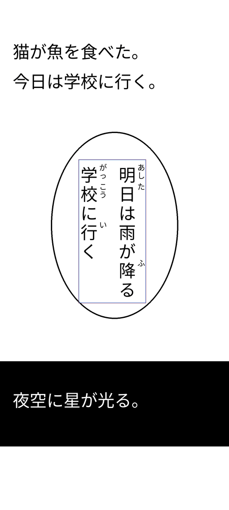
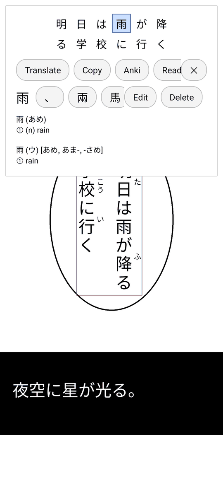

# gaku-local

**Gaku** is a Japanese dictionary for Android that reads text straight off your screen. Drag its box over Japanese text in any app, such as a manga reader, a game or a photo, double-tap, and Gaku shows what the words mean. It's made for text you can't select and copy. This version reads the text and looks up the words on your device.

> **Made with Claude Code.** This version's changes were made by [Claude Code](https://claude.com/claude-code), Anthropic's AI coding assistant, with some direction from the repo's owner. The app itself comes from [Kaku](https://github.com/0xbad1d3a5/Kaku) by 0xbad1d3a5 and [Gaku](https://github.com/ExecuteOrd66/Gaku) by Carl Oosthuizen. See [what's changed](CHANGES.md).

  
  &nbsp;&nbsp;
  

## What you need

- An Android phone or tablet with Android 7.0 or newer, running 64-bit Android, as nearly every device from the last several years does.
- About 250 MB of space. Gaku carries its own dictionary and text reader, so it works without an internet connection.

## Download and install

1. On the [Releases](../../releases) page, download the newest APK. There are two:
   - **gaku-offline** (choose this one if unsure) has no internet access at all.
   - **gaku-lan** is the same, plus optional translations and explanations from an AI model on a server you choose. See [Translation with your own model](#translation-with-your-own-model).
2. Open the downloaded file on your phone. Android asks you to allow installing apps from your browser or file manager: allow it, then tap **Install**.
3. Google Play Protect may warn that it doesn't recognise the app, because it isn't from the Play Store. Tap **More details**, then **Install anyway**.

If there's no release yet, you can [build it yourself](CONTRIBUTING.md#building).

## Getting started

1. Open Gaku and swipe through the short tutorial.
2. Allow **Display over other apps**, which the box needs, and **Notifications** if you'd like Hide, Show and Shutdown buttons in your notifications.
3. Tap **Start Gaku**. When Android asks what to share, choose **Entire screen**, then start.
4. Open the app you want to read, drag the box over some Japanese text, and resize it from its bottom-right corner.
5. Double-tap the box. The results open with the first word looked up: tap any other character to look it up from there.

## Tips

- **Nothing happens when you double-tap?** If you shared one app instead of the entire screen, Gaku can only read that app, and only while it fills the screen. Stop Gaku and start it again, choosing the entire screen.
- **A character was misread?** Tap it in the results. Lookalike characters appear below it: tap one to swap it in, use **Edit** to type or handwrite the right one, or **Delete** it.
- **Single words:** turn on **Instant** in the results, and a small box is read as soon as you let go of it.
- **Closing the results:** tap **✕**, press **Back**, or tap outside them.
- **Shortcuts,** if you'd rather use gestures: in the results, long-press a character to copy the text, or drag a character down onto a lookalike to swap it in, up and to the left to edit it, or up and to the right to delete it. Flick a blank part of the results upwards to close them, and tap the far left or right of long text to page through it.
- **Hiding the box:** use Gaku's notification, its Quick Settings tile or its start screen. Turning the screen off hides it too. **Stop** ends screen sharing.
- **Text you can select,** such as on a web page: select it and choose **Gaku** from the menu (it may be under ⋮), or share it to Gaku.

## Anki

If you study with [AnkiDroid](https://github.com/ankidroid/Anki-Android), Gaku can add the words you look up to a deck. Install AnkiDroid and open it once. Then, on Gaku's start screen, tap **Connect AnkiDroid**, allow it, and choose a deck. The **Anki** button in the results adds the word, its reading and meaning, and the text it was in. The cards use a note type called Gaku, which you can restyle in AnkiDroid.

## Translation with your own model

The **gaku-lan** version can also ask an AI model to translate the text or explain it. The model runs in [Ollama](https://ollama.com) on a computer or server you choose, not on Google's or anyone else's. Once it's set up, **Translate** shows your model's translation, **Google** opens Google Translate instead, and **Ask** opens a chat about the sentence, with buttons for its grammar, a word-by-word breakdown or its nuance.

Setting it up

- Run Ollama where your phone can reach it, listening on the network rather than only on its own computer (`OLLAMA_HOST=0.0.0.0`), and pull a model. One trained for Japanese, such as Shisa, is a good choice.
- On Gaku's start screen, type the server's address under **Ollama server**: for example `192.168.1.10` (port 11434 is assumed), or `https://ollama.example.com` for a server behind HTTPS (port 443). Add an **API key** if the server needs one.
- Tap **Connect**, then choose a model. To turn it off again, clear the address and tap **Connect**.
- If your phone and the server are on different networks, [Tailscale](https://tailscale.com) can join them. To keep things tight, share just the server with the phone's Tailscale account, and allow it only port 11434.
- Plain `http://` to a server outside your own network works, but the start screen warns you: your text would cross the internet unencrypted.

## Privacy

- Gaku only looks at your screen while it's showing, and what it captures stays in memory. Nothing is saved to storage or written to logs.
- Reading text and looking up words happen on your device. The gaku-offline version can't connect to the internet at all.
- Text only leaves Gaku when you tap a button: **Translate** (Google Translate's app, or your own server in gaku-lan), **Ask** (your server), **Copy**, or **Anki** (AnkiDroid on your phone, whose own sync may upload it).
- One exception: **Read with ML Kit** uses Google's ML Kit, which can send usage statistics, such as timings, through Google Play services. Not your text or images.

More detail: [Privacy and security](CHANGES.md#privacy-and-security) in the list of changes.

## Help and feedback

- **Something not working?** [Report it](../../issues/new/choose), saying which phone, which Android version, and what happened.
- **Want to help improve Gaku?** See [CONTRIBUTING.md](CONTRIBUTING.md).

## Licence and credits

Gaku is open source, under the [BSD 3-Clause licence](LICENSE): anyone may use, change and share it, as long as the copyright notice comes with it. Some bundled data has its own licence. The app lists all of these, and the libraries it uses, under **Credits and licences** on its start screen:

- The dictionary includes material from the JMdict and KANJIDIC2 dictionary files, used in accordance with the licence provisions of the [Electronic Dictionary Research and Development Group](https://www.edrdg.org/edrdg/licence.html), CC BY-SA 4.0. The bundled database is built from the files of 30 October 2026, and is itself under CC BY-SA 4.0.
- The deinflection rules in `deinflect.dat` are by Jonathan Zarate, from Rikaichan, which is under the GNU GPL (version 2 or later). The file keeps those terms, not this repo's.
- Visually similar kanji come from Lars Yencken's [kanji confusion data](https://lars.yencken.org/datasets/kanji-confusion/) (Yencken & Baldwin, 2008), [CC BY 3.0](https://creativecommons.org/licenses/by/3.0/).
- [manga-ocr](https://github.com/kha-white/manga-ocr) by Maciej Budyś, Apache-2.0, using the int8 ONNX export from [onnx-community/manga-ocr-base-ONNX](https://huggingface.co/onnx-community/manga-ocr-base-ONNX), run with [ONNX Runtime](https://onnxruntime.ai/), MIT.
- [Google ML Kit](https://developers.google.com/ml-kit) text recognition for Japanese, under Google's ML Kit terms. It isn't open source.
